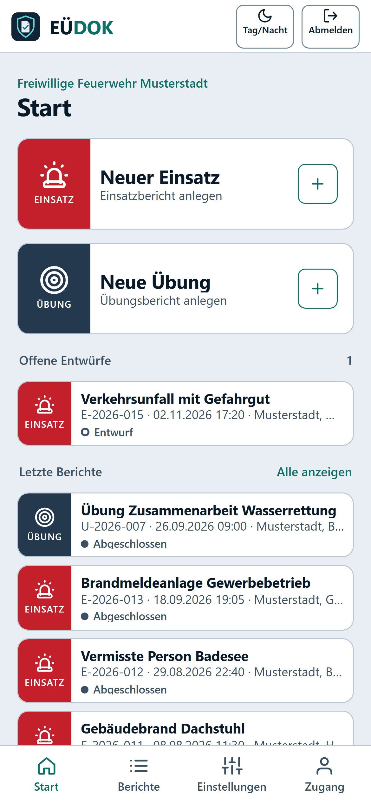
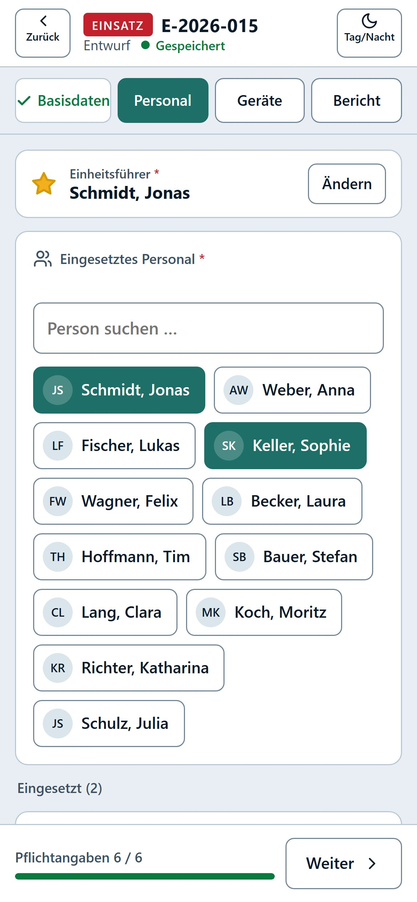
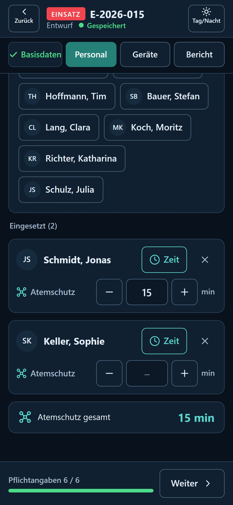
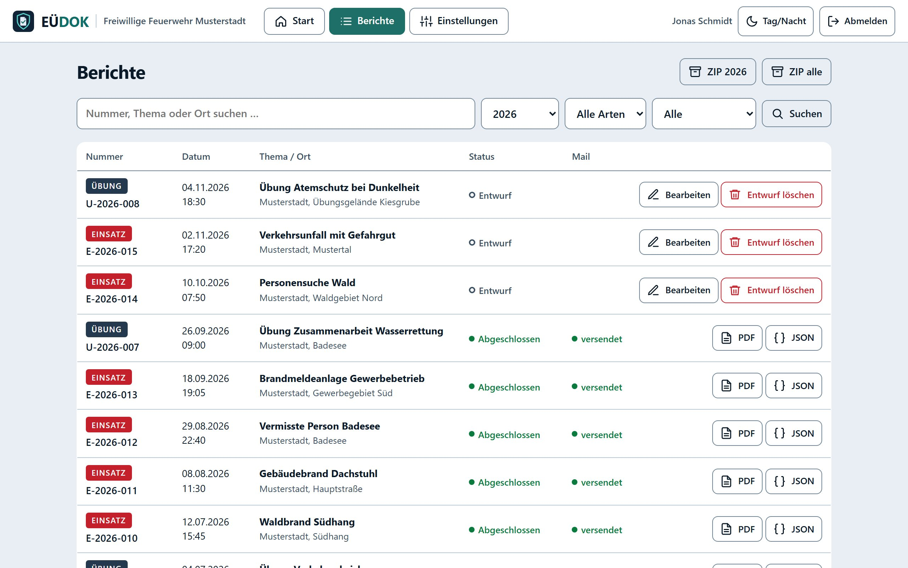
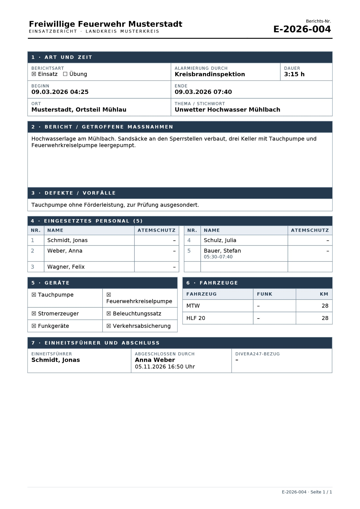
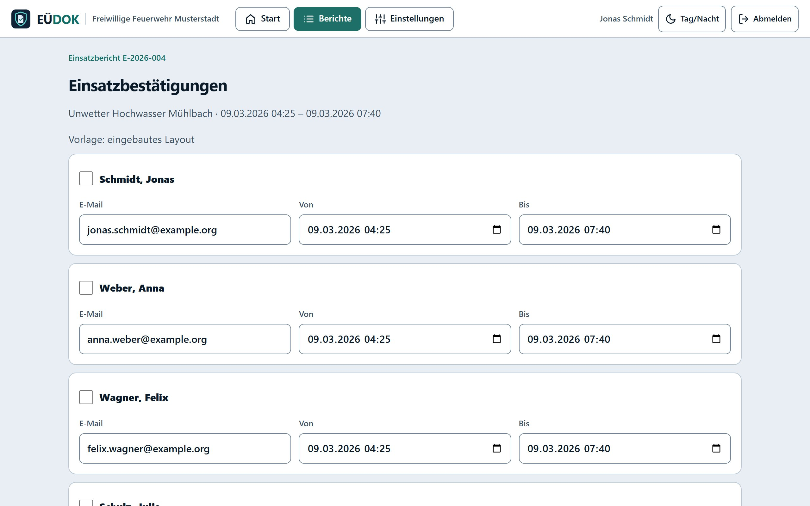

# EÜDOK – Einsatz- & Übungsdokumentation

**Einsatz- und Übungsberichte für Feuerwehr und Hilfsorganisationen.** Direkt nach dem Einsatz am
Handy erfasst, beim Abschließen als PDF abgelegt und per Mail verschickt – statt Papierbogen,
Excel-Tabelle und Abtippen am nächsten Abend.

EÜDOK läuft auf normalem PHP-Webhosting, braucht keine Datenbank und keine App aus dem Store.
Alle Daten bleiben auf dem eigenen Server.

  
  
  

## So funktioniert es

1. **Erfassen:** „Neuer Einsatz“ oder „Neue Übung“ antippen. Zeiten, Ort, Personal, Fahrzeuge und
   Geräte – auf Wunsch direkt aus der Divera247-Alarmierung übernommen. Alles wird laufend
   gespeichert, auch ohne Netz auf dem Gerät.
2. **Abschließen:** Der Bericht wird als PDF und JSON abgelegt und an die eingestellten Adressen
   verschickt. Korrekturen laufen als „Korrektur 1, 2, …“ mit eigenem PDF.
3. **Nachweisen:** Einsatzbestätigungen für den Arbeitgeber gehen mit wenigen Klicks an die
   betroffenen Mitglieder, die Übersicht exportiert alles als ZIP.

## Funktionen

**Erfassen**
- Berichtsformular für Handy, Tablet und PC, mit Tag- und Nachtansicht
- Divera247: Alarme (Einsatz) bzw. Termine (Übung) übernehmen, Personal und Fahrzeuge live
- Abweichende Zeiten pro Person („gekommen“, „gegangen“), auch über Mitternacht
- Eigene Formularfelder, z. B. Atemschutz-Minuten
- QR-Schnellerfassung am Fahrzeug, optional mit PIN, ohne eigene Anmeldung

**Ablegen und versenden**
- PDF mit eigener Fußzeile und JSON je Bericht, nach Jahren abgelegt
- Mailversand beim Abschließen, „Erneut senden“, ZIP-Export pro Jahr oder komplett
- Einsatzbestätigungen per Mail, mit eigener PDF-Vorlage und mehreren Layouts

**Verwalten und absichern**
- Einstellungsseite für alles, Einrichtungsassistent, Änderungsprotokoll
- Zugänge mit Admin-Rolle, eigenes Passwort ändern, optionale Zwei-Faktor-Anmeldung (TOTP)
- Sperre nach Fehlversuchen, CSRF-Schutz, verschlüsselte Zugangsdaten
- Update in der App: nur signierte Pakete aus den GitHub-Releases, mit Rücksicherung

  
  

## Installation

Voraussetzung: Webhosting mit PHP ≥ 8.1 (Erweiterungen `sodium`, `gd`, `zip`, `curl`, `mbstring`)
und HTTPS.

1. Das neueste Paket `euedok-x.y.z.zip` unter [Releases](https://github.com/ugdrohnelandshutland/euedok/releases/latest)
   herunterladen und entpacken.
2. Die Ordner `public/`, `app/` und `vendor/` auf den Webspace hochladen.
3. Den **Dokumentstamm** der Domain auf `…/public` stellen (z. B. in Plesk unter Hosting-Einstellungen).
   `app/`, `vendor/` und die Daten liegen damit außerhalb des Web-Roots.
4. HTTPS aktivieren (z. B. Let's Encrypt).
5. Die Adresse aufrufen – der Einrichtungsassistent führt durch den Rest.
6. Unter Einstellungen Mailversand (SMTP-Postfach), Divera247-Schlüssel und QR-Zugänge eintragen.

**Update:** Einstellungen → Update → „Jetzt nach Updates suchen“. Installiert werden nur signierte
Pakete aus den GitHub-Releases; der vorherige Stand bleibt gesichert und lässt sich dort
wiederherstellen. Die Daten werden nie überschrieben.

**Sicherung:** den Ordner `data/` komplett sichern, inklusive `keys/`.

## Mitentwickeln

Lokale Entwicklung, Release-Ablauf, Ablage und Protokolle: [docs/ENTWICKLUNG.md](docs/ENTWICKLUNG.md) ·
Konzept: [KONZEPT.md](KONZEPT.md)

## Lizenz

[MIT](LICENSE)
